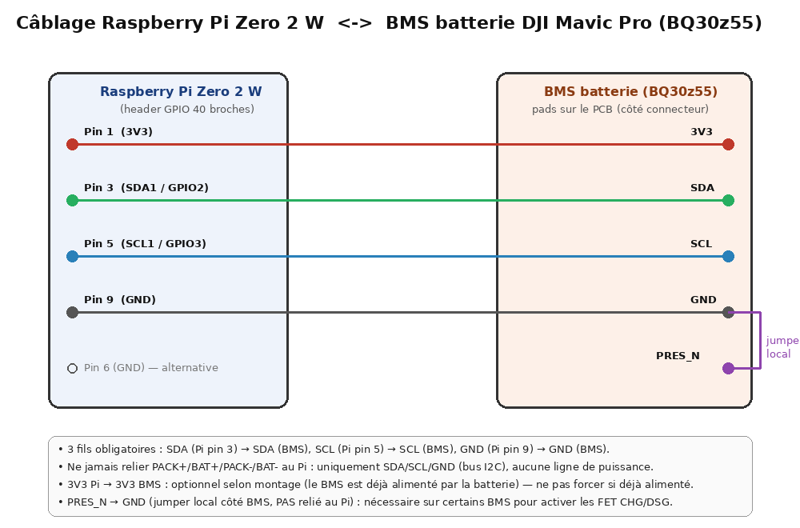
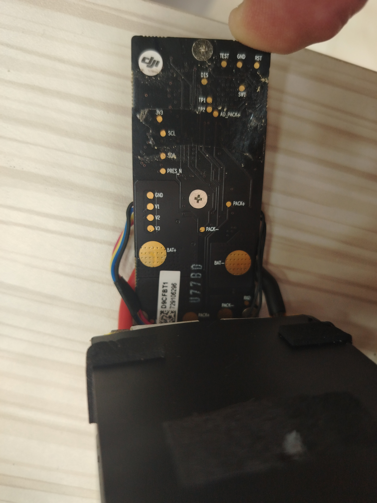

# Outil batterie DJI Mavic Pro (BQ30z55) — interface web

Répertoire minimal contenant uniquement ce qui est nécessaire pour dialoguer
avec le BMS de la batterie (pas l'ensemble du dépôt `dji-firmware-tools`).

Interface web (Flask) : serveur intégré, accès depuis n'importe quel
navigateur, aucun X11/VNC nécessaire — parfait avec un accès SSH seul.

## Licence et attribution

`comm_sbs_bqctrl.py` et `comm_sbs_chips/BQ30z554.py` sont repris **sans
modification** du dépôt [o-gs/dji-firmware-tools](https://github.com/o-gs/dji-firmware-tools),
sous licence **GPL-3.0**. Voir `LICENSE` pour le texte complet. Le reste
du code (`bq_bridge.py`, `web_app.py`) est écrit pour ce projet.

## Contenu

```
battery_tool/
├── LICENSE                    # texte de la licence GPL-3.0
├── comm_sbs_bqctrl.py         # moteur SBS/SMBus (o-gs/dji-firmware-tools, GPL-3.0, non modifié)
├── comm_sbs_chips/
│   └── BQ30z554.py            # profil de la puce (o-gs/dji-firmware-tools, GPL-3.0, non modifié)
├── bq_bridge.py                # logique partagée (bootstrap I2C) — écrit pour ce projet
├── web_app.py                   # serveur web Flask (ce que vous lancez) — écrit pour ce projet
├── docs/
│   ├── wiring_diagram.png       # schéma de câblage Pi <-> BMS
│   └── bms_pads_reference.jpg   # photo annotée des pads du BMS
└── README.md
```

`bq_bridge.py` importe `comm_sbs_bqctrl.py` comme une bibliothèque Python
(sans passer par sa ligne de commande) et expose les fonctions internes
(`smart_battery_system_read`, `smart_battery_system_monitor`,
`smart_battery_system_sealing`, `smart_battery_system_trigger`) via une
petite classe `Session`, utilisée par `web_app.py`.

## Installation (Raspberry Pi OS)

```bash
sudo apt update
sudo apt install -y python3-pip i2c-tools
pip3 install flask smbus2
sudo raspi-config   # Interface Options → I2C → Yes, puis reboot
```

## Câblage



- **3 fils obligatoires** : `SDA` (Pi pin 3) → `SDA` (BMS), `SCL` (Pi pin 5) → `SCL` (BMS),
  `GND` (Pi pin 9, ou pin 6) → `GND` (BMS).
- Ne jamais relier `PACK+`/`BAT+`/`PACK-`/`BAT-` au Pi : uniquement le bus I2C
  (`SDA`/`SCL`/`GND`), aucune ligne de puissance.
- `3V3` Pi → `3V3` BMS : optionnel selon le montage (le BMS est déjà alimenté
  par les cellules de la batterie) — ne pas forcer si déjà alimenté.
- `PRES_N` → `GND` (jumper **local côté BMS**, pas relié au Pi) : nécessaire
  sur certains BMS pour que le firmware active les FET `CHG`/`DSG`, indépendamment
  du flag Permanent Failure.

Référence des pads réels sur le PCB (photo annotée du BMS utilisé pour ce projet) :



Vérifiez la connexion avant de lancer l'appli :

```bash
sudo i2cdetect -y 1
```

L'adresse `0x0b` doit apparaître.

## Lancement

```bash
cd battery_tool
python3 web_app.py
```

Le terminal affiche `Serveur sur http://0.0.0.0:5000`. Depuis votre
ordinateur ou téléphone, ouvrez dans un navigateur :

```
http://<ip-du-pi>:5000
```

(remplacez `<ip-du-pi>` par l'adresse IP affichée par `hostname -I` sur
le Pi). Laissez le terminal SSH ouvert tant que vous utilisez l'interface
— fermer la session SSH arrête le serveur (voir « Garder le serveur actif
après déconnexion » ci-dessous).

Selon les permissions du groupe `i2c`, il peut être nécessaire de lancer
avec `sudo python3 web_app.py`.

### Garder le serveur actif après déconnexion SSH

```bash
nohup python3 web_app.py > web_app.log 2>&1 &
disown
```

Vous pouvez alors fermer la session SSH ; le serveur continue de tourner.
Pour l'arrêter plus tard : `pkill -f web_app.py`.

## Scénario d'exécution — ordre des boutons

0. **Identifier la puce** *(optionnel mais recommandé)* — lit le numéro
   de puce directement en I2C, fonctionne même batterie scellée. Plus
   fiable qu'une lecture visuelle du marquage imprimé, souvent masqué
   par le vernis de protection de la carte.
1. **Connecter** — établit la liaison I2C avec le BMS
2. **Lire → BatteryStatus** — vérifie que la communication répond
3. **Monitor → BQCellVoltages** — confirme que les cellules sont saines
   *(si le MCU ne répond pas à ce stade, utilisez **Redémarrer** ici en
   dépannage, puis reprenez à l'étape 2 — voir note ci-dessous)*
4. **Unseal** — déverrouille l'accès en écriture
5. **FullAccess** — accès complet nécessaire pour la suite
6. **Exécuter (PermanentFailDataReset)** — efface le flag PF
7. **Lire → BatteryStatus** — vérifie que le flag est bien effacé
8. **Seal** — reverrouille la puce (ne jamais sauter cette étape)
9. **Redémarrer (DeviceReset)** — validation finale, une fois la puce scellée
10. **Lire → BatteryStatus** — confirme que le flag reste effacé après un
    reset complet (équivalent d'un débranchement/rebranchement réel)

**Pourquoi le reboot vient après Seal, pas avant :** un reset matériel
équivaut, sur toute la famille TI BQ, à une commande `Seal` — il reverrouille
automatiquement la puce. Le faire tôt (avant l'effacement du PF) obligerait
à refaire Unseal/FullAccess juste après pour rien. Le faire en toute fin,
une fois déjà scellé, en fait au contraire un vrai test de validation :
si le flag PF revient après ce reset, la cause sous-jacente (ex. cellule
encore sous tension) est toujours active malgré l'effacement.

## Utilisation

1. **Connexion** : bus `i2c:1`, adresse `0x0b` (valeurs par défaut), clé
   SHA-1 par défaut TI (à changer seulement si DJI a personnalisé la clé
   de votre batterie — dans ce cas l'Unseal échouera avec la clé par
   défaut).
2. **Lecture** : commandes rapides (BatteryStatus, Voltage, Temperature...)
   ou un groupe `monitor` entier (ex. `BQCellVoltages` pour les tensions
   de chaque cellule).
3. **Sealing** : Unseal → FullAccess avant de pouvoir effacer un flag,
   Seal pour reverrouiller à la fin.
4. **Effacer le flag PF** : commande pré-remplie
   `ManufacturerAccess.PermanentFailDataReset`, confirmée dans le fichier
   de la puce comme étant la bonne commande pour ce modèle. Une boîte de
   confirmation s'affiche avant toute action d'écriture.

Toute la sortie (y compris les erreurs) s'affiche dans la console noire
en bas de la page, rafraîchie automatiquement.

## Sécurité

- Ce serveur n'a aucune authentification — gardez-le sur votre réseau
  local, ne l'exposez pas sur Internet.
- Ne branchez jamais de ligne d'alimentation entre le Pi et la batterie
  (seulement SDA/SCL/GND) — la batterie garde ses propres cellules comme
  source.
- Ne pressez pas le bouton de la batterie pendant que l'application est
  connectée — cela peut interférer avec la communication I2C.
- Après un `sealing Seal`, débranchez avant de retester la batterie sur
  son chargeur d'origine.

## Personnalisation

Le titre affiché (`APP_TITLE` dans `web_app.py`) peut être changé librement.
L'application n'embarque aucun logo ni branding.
